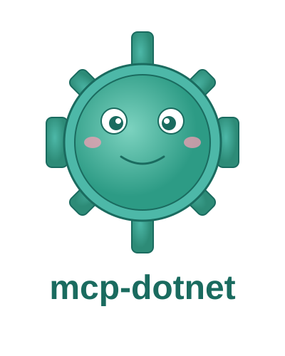
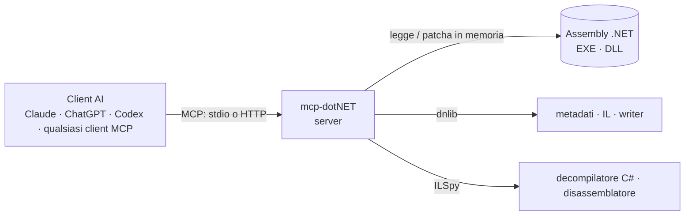

# mcp-dotNET


[🇬🇧 English](README.md) · 🇮🇹 Italiano

**Gli assembly .NET leggibili e modificabili dal tuo assistente AI.**

> **Fork di [neoz/mcp-dotnet (MCPPOC)](https://github.com/neoz/mcp-dotnet)**, ricostruito sull'SDK MCP C# 2.x e su .NET 10. Crediti in [NOTICE.md](NOTICE.md), modifiche in [CHANGELOG.md](CHANGELOG.md).

mcp-dotNET è un server [MCP](https://modelcontextprotocol.io) che permette a Claude, ChatGPT, Codex e a qualunque altro client MCP di analizzare assembly .NET: esplorare i metadati, seguire i riferimenti incrociati, leggere l'IL, **decompilare in C# con il motore di ILSpy**, cercare API rilevanti per la sicurezza e **modificare l'IL e salvare** il risultato. È basato su [dnlib](https://github.com/0xd4d/dnlib) e [ICSharpCode.Decompiler (ILSpy)](https://github.com/icsharpcode/ILSpy). Solo analisi statica: il server non esegue mai il codice che ispeziona.

[Installazione](docs/it/installation.md) · [Personalizzazione e funzionamento](docs/it/tweaking.md) · [FAQ](docs/it/faq.md)

## Perché ti piacerà

- **Legge gli assembly come si deve.** Tipi (inclusi quelli annidati e generati dal compilatore), metodi, campi, proprietà, eventi, risorse — ciascuno con il token di metadati che ogni strumento accetta.
- **Decompila con ILSpy.** C# completo di un metodo, di un tipo o dell'intero assembly, più disassemblaggio IL in stile ildasm e grafi di controllo di flusso reali con diagramma Mermaid.
- **Segue il codice.** Chiamanti, chiamati, letture/scritture di campi, usi di tipi e tipi derivati.
- **Fa triage di sicurezza.** Una scansione segnala caricamento dinamico di codice, P/Invoke di iniezione (VirtualAlloc, WriteProcessMemory…), avvio di processi, rete, crittografia, registro, deserializzazione non sicura, anti-debug e keylogging, con conteggi per categoria e rilevamento di offuscatori.
- **Modifica l'IL e salva.** Sostituisci, inserisci, elimina o azzera (NOP) istruzioni, sostituisci un intero corpo, rinomina membri per il deoffuscamento — e la decompilazione riflette subito la modifica.
- **Due trasporti.** stdio per i client desktop, Streamable HTTP con autenticazione bearer per Claude Code e configurazioni condivise.
- **Sicuro per impostazione predefinita.** La modalità `--read-only` rimuove ogni strumento che modifica o scrive un assembly.

## Cosa puoi chiedere

| Obiettivo | Esempio di richiesta | Strumenti |
|---|---|---|
| Capire un binario | "cosa fa `App.dll`? parti dai punti d'ingresso" | `load_assembly`, `get_entry_points`, `decompile` |
| Trovare codice | "quali metodi validano la licenza?" | `find_methods`, `find_strings`, `decompile` |
| Seguire i riferimenti | "chi chiama `CheckLicense`? cosa legge?" | `find_callers`, `find_callees`, `find_field_references` |
| Triage di sicurezza | "questo campione inietta codice o contatta la rete?" | `scan_suspicious_apis`, `list_pinvokes`, `list_resources` |
| Leggere l'IL | "mostra l'IL e il grafo di flusso di questo metodo" | `get_method_il`, `get_control_flow_graph`, `disassemble` |
| Patchare | "fai passare sempre il controllo trial e salva una copia patchata" | `replace_method_body`, `save_assembly` |
| Deoffuscare | "rinomina questi membri `a.b.c` man mano che li capisci" | `rename_member`, `decompile` |
| Estrarre | "estrai la risorsa incorporata in un file" | `list_resources`, `get_resource` |

In totale: **36 strumenti**, 3 risorse e 3 prompt. L'elenco completo è nel [riferimento degli strumenti](docs/it/tweaking.md#strumenti).

## Come funziona



1. **Il client parla MCP con il server,** via stdio (Claude Desktop, app desktop di ChatGPT, Codex) o Streamable HTTP (Claude Code, server condivisi).
2. **Il server carica gli assembly in memoria** con dnlib, così i file originali non vengono mai bloccati e un assembly patchato può esservi riscritto sopra.
3. **La decompilazione usa il motore di ILSpy,** e quando un assembly è stato patchato o rinominato nella sessione viene prima serializzato in memoria, così il C# riflette lo stato corrente.
4. **Nulla viene eseguito.** Ogni strumento è analisi statica; la patch modifica un modello in memoria che salvi esplicitamente.

## Avvio rapido

Serve il [SDK .NET 10](https://dotnet.microsoft.com/download). Poi:

```powershell
git clone https://github.com/jumpifequal/mcp-dotnet C:\Tools\mcp-dotnet
cd C:\Tools\mcp-dotnet
powershell -ExecutionPolicy Bypass -File .\Scripts\install.ps1        # build + registra tutti i client (stdio)
```

Riavvia il client e chiedi: *"carica C:\percorso\App.dll e riassumi cosa fa a partire dai punti d'ingresso."* Il [manuale di installazione](docs/it/installation.md) copre lo script, la configurazione manuale, il trasporto HTTP e come verificare che tutto funzioni.

## Compatibile con

| Client | Connessione | Configurazione |
|---|---|---|
| Claude Desktop | stdio | [Installazione](docs/it/installation.md#collega-il-tuo-client-ai) |
| Claude Code | stdio o Streamable HTTP | [Trasporto HTTP](docs/it/installation.md#trasporto-http) |
| App desktop ChatGPT, Codex CLI / IDE | stdio | [Client OpenAI](docs/it/installation.md#client-openai) |
| Qualsiasi altro client MCP | stdio o HTTP | [Installazione](docs/it/installation.md#collega-il-tuo-client-ai) |

## La console

`Scripts\console.bat` apre una GUI nativa (profili, Avvia/Ferma/Riavvia, stato del workspace in tempo reale, un log filtrabile e il pannello Problems, build/test, e registrazione con un clic in Claude Code/Desktop/Codex) — utile quando esponi il server via HTTP; ripiega su una console testuale se il Windows Desktop Runtime non è disponibile. Vedi [la console](docs/it/tweaking.md#console).

## Documentazione

| Manuale | Per |
|---|---|
| [Installazione](docs/it/installation.md) | installare con lo script o a mano; collegare Claude, Codex e ChatGPT; il trasporto HTTP; verificare e disinstallare |
| [Personalizzazione e funzionamento](docs/it/tweaking.md) | capire l'architettura, ogni strumento, la sintassi di patch IL, le opzioni da riga di comando, la console e la sicurezza |
| [FAQ e risoluzione problemi](docs/it/faq.md) | risolvere problemi di setup e uso, conoscere i limiti |

## Sicurezza in breve

- Solo statico: il server non esegue mai un assembly analizzato.
- `--read-only` rimuove tutti gli strumenti di patch/rename/save.
- L'HTTP richiede un token bearer (bind su loopback per impostazione predefinita); `--no-auth` è rifiutato fuori dal loopback e un bind non-loopback senza TLS viene segnalato.
- Codice decompilato, stringhe e risorse sono contenuti di terze parti: il server li tratta come dati; evita di combinare l'analisi di un campione non fidato con strumenti ad alto impatto (email, shell, browser) nella stessa sessione.
- Note complete in [Sicurezza](docs/it/tweaking.md#note-di-sicurezza).

## Contesto

Questo progetto è un fork di **[neoz/mcp-dotnet](https://github.com/neoz/mcp-dotnet)** (la proof of concept "MCPPOC"). Mantiene l'idea originale e la base dnlib + ILSpy e ricostruisce il server sull'SDK MCP attuale con un set di strumenti più ampio e verificato. Crediti in [NOTICE.md](NOTICE.md).

## Licenza

MIT. Analizza solo software che sei autorizzato ad analizzare, nel rispetto delle licenze e delle leggi applicabili.
