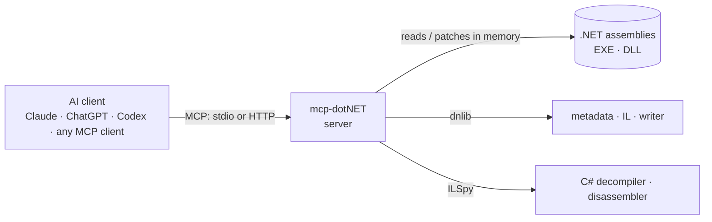

# mcp-dotNET

🇬🇧 English · [🇮🇹 Italiano](README.it.md)

**Your .NET assemblies, readable and patchable by your AI assistant.**

> **Fork of [neoz/mcp-dotnet (MCPPOC)](https://github.com/neoz/mcp-dotnet)**, rebuilt on the MCP C# SDK 2.x and .NET 10. See [NOTICE.md](NOTICE.md) for credits and [CHANGELOG.md](CHANGELOG.md) for what changed.

mcp-dotNET is an [MCP](https://modelcontextprotocol.io) server that lets Claude, ChatGPT, Codex and any other MCP client analyse .NET assemblies: browse metadata, follow cross-references, read IL, **decompile to C# with the ILSpy engine**, scan for security-relevant APIs, and **patch IL and save** the result. It is built on [dnlib](https://github.com/0xd4d/dnlib) and [ICSharpCode.Decompiler (ILSpy)](https://github.com/icsharpcode/ILSpy). Static analysis only — the server never runs the code it inspects.

[Install it](docs/en/installation.md) · [Tweak it and see how it works](docs/en/tweaking.md) · [FAQ](docs/en/faq.md)

## Why you will like it

- **Reads assemblies properly.** Types (including nested and compiler-generated ones), methods, fields, properties, events, resources — each with the metadata token every tool accepts.
- **Decompiles with ILSpy.** Full C# for a method, a type or the whole assembly, plus ildasm-style IL disassembly and real control-flow graphs with a Mermaid diagram.
- **Follows the code.** Callers, callees, field reads/writes, type usages and derived types — the cross-references you need to understand a binary.
- **Triages for security.** One scan flags dynamic code loading, injection P/Invokes (VirtualAlloc, WriteProcessMemory…), process launch, network, crypto, registry, unsafe deserialization, anti-debugging and keylogging, with per-category counts and obfuscator detection.
- **Patches IL and saves.** Replace, insert, delete or NOP instructions, replace a whole body, rename members for deobfuscation — and decompiled output reflects the change immediately.
- **Two transports.** stdio for desktop clients, Streamable HTTP with bearer auth for Claude Code and shared setups.
- **Safe by default.** A `--read-only` mode removes every tool that modifies or writes an assembly.

## What you can ask

| Goal | Example request | Tools involved |
|---|---|---|
| Understand a binary | "what does `App.dll` do? start from the entry points" | `load_assembly`, `get_entry_points`, `decompile` |
| Find code | "which methods validate the license?" | `find_methods`, `find_strings`, `decompile` |
| Follow references | "who calls `CheckLicense`? what does it read?" | `find_callers`, `find_callees`, `find_field_references` |
| Security triage | "does this sample inject code or phone home?" | `scan_suspicious_apis`, `list_pinvokes`, `list_resources` |
| Read IL | "show the IL and control-flow graph of this method" | `get_method_il`, `get_control_flow_graph`, `disassemble` |
| Patch | "make the trial check always pass and save a patched copy" | `replace_method_body`, `save_assembly` |
| Deobfuscate | "rename these `a.b.c` members as you work them out" | `rename_member`, `decompile` |
| Extract | "dump the embedded resource to a file" | `list_resources`, `get_resource` |

In total: **36 tools**, 3 resources and 3 prompts. The full list is in the [tools reference](docs/en/tweaking.md#tools).

## How it works



1. **The client talks MCP to the server,** over stdio (Claude Desktop, ChatGPT desktop app, Codex) or Streamable HTTP (Claude Code, shared servers).
2. **The server loads assemblies into memory** with dnlib, so the original files are never locked and a patched assembly can be written over them.
3. **Decompilation uses the ILSpy engine,** and when an assembly has been patched or renamed in the session it is serialized in memory first, so the C# reflects the current state.
4. **Nothing is executed.** Every tool is static analysis; patching changes an in-memory model that you explicitly save.

## Quick start

You need [.NET 10 SDK](https://dotnet.microsoft.com/download). Then:

```powershell
git clone https://github.com/jumpifequal/mcp-dotnet C:\Tools\mcp-dotnet
cd C:\Tools\mcp-dotnet
powershell -ExecutionPolicy Bypass -File .\install.ps1        # build + register all clients (stdio)
```

Restart your client and ask: *"load C:\path\to\App.dll and summarise what it does from the entry points."* The [installation manual](docs/en/installation.md) covers the install script, manual configuration, the HTTP transport and how to check that everything works.

## Works with

| Client | Connection | Setup |
|---|---|---|
| Claude Desktop | stdio | [Installation](docs/en/installation.md#connect-your-ai-client) |
| Claude Code | stdio or Streamable HTTP | [HTTP transport](docs/en/installation.md#http-transport) |
| ChatGPT desktop app, Codex CLI / IDE | stdio | [OpenAI clients](docs/en/installation.md#openai-clients) |
| Any other MCP client | stdio or HTTP | [Installation](docs/en/installation.md#connect-your-ai-client) |

## The console

`console.bat` opens a native GUI (profiles, Start/Stop/Restart, live workspace status, a filterable log and Problems panel, build/test, and one-click registration with Claude Code/Desktop/Codex) — useful when you expose the server over HTTP; falls back to a text console if the Windows Desktop Runtime isn't available. See [the console](docs/en/tweaking.md#console).

## Documentation

| Manual | Read it to |
|---|---|
| [Installation](docs/en/installation.md) | install with the script or by hand; connect Claude, Codex and ChatGPT; the HTTP transport; check and uninstall |
| [Tweaking and under the hood](docs/en/tweaking.md) | understand the architecture, every tool, the IL-patch syntax, the command-line flags, the console and security |
| [FAQ and troubleshooting](docs/en/faq.md) | solve setup and usage problems, and know the limits |

## Safety in brief

- Static only: the server never executes an analysed assembly.
- `--read-only` removes all patch/rename/save tools.
- HTTP needs a bearer token (loopback bind by default); `--no-auth` is refused off loopback, and a non-loopback bind without TLS is warned about.
- Decompiled code, strings and resources are third-party content: the server treats them as data, and you should not combine analysis of an untrusted sample with high-impact tools (email, shell, browser) in the same session.
- Full notes in [Security](docs/en/tweaking.md#security-notes).

## Background

This project is a fork of **[neoz/mcp-dotnet](https://github.com/neoz/mcp-dotnet)** (the "MCPPOC" proof of concept). It keeps the original idea and the dnlib + ILSpy foundation and rebuilds the server on the current MCP SDK with a larger, verified tool set. Credits are in [NOTICE.md](NOTICE.md).

## Licence

MIT. Analyse only software you are authorised to analyse, and respect licences and applicable law.
