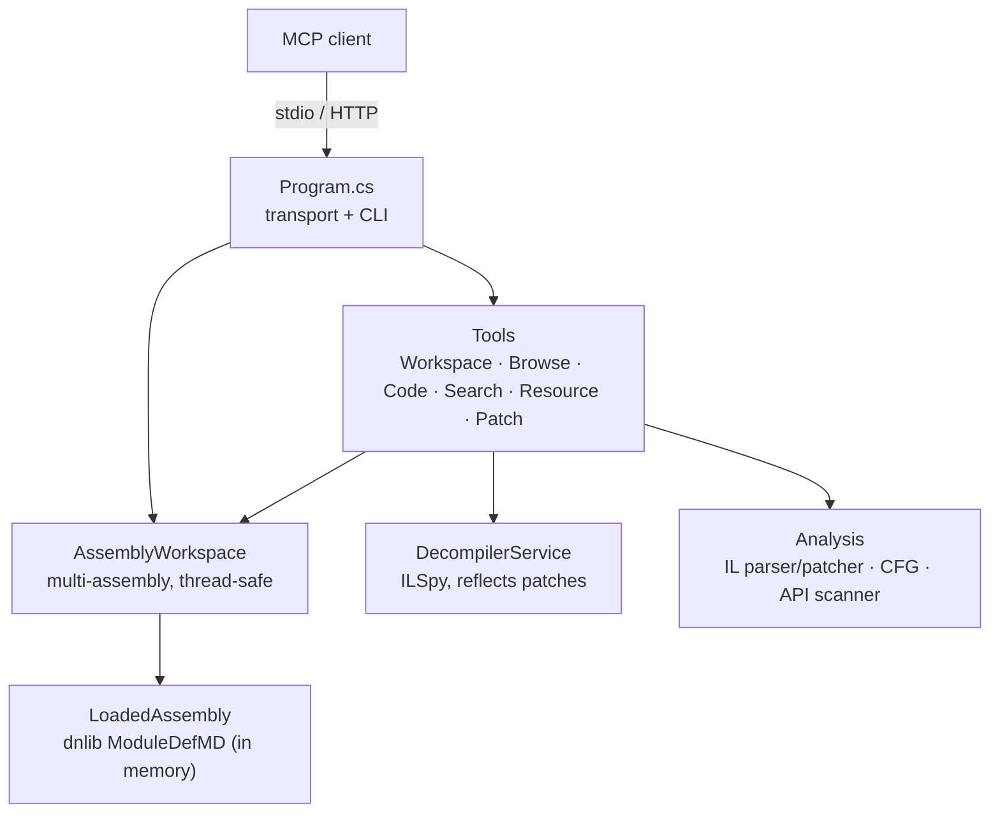

# Tweaking and under the hood

🇬🇧 English · [🇮🇹 Italiano](../it/tweaking.md)

## Architecture



- **Workspace.** Assemblies are loaded from a byte copy, so the file on disk is never locked and a patched assembly can be saved over the original. Each assembly has an id; tools default to the active one or take an `assembly` argument. Access is guarded by a reader/writer lock because MCP requests may run in parallel.
- **Decompiler.** Wraps the ILSpy engine. When an assembly is unmodified it decompiles the file; once patched or renamed, the module is serialized to memory first, so the C# always matches the current state. Results are cached per assembly version.
- **Analysis.** A textual-IL parser/patcher (round-trips 100% of the instructions in `dnlib.dll`), a basic-block control-flow builder, and a rule-based API scanner.

## Tools

Members are addressed by **metadata token** (`0x06000012`), returned and accepted by every tool. Names also work when unambiguous: `Namespace.Type`, `Outer+Inner`/`Outer/Inner`, `Namespace.Type::Method`, `Namespace.Type::Method(int32,string)`. List tools are paginated (`offset`, `limit`, `nextOffset`).

| Area | Tools |
|---|---|
| Workspace | `load_assembly`, `list_assemblies`, `set_active_assembly`, `unload_assembly`, `get_assembly_info`, `list_assembly_references` |
| Browse | `list_namespaces`, `list_types`, `get_type`, `find_methods`, `find_members`, `get_method`, `get_entry_points`, `list_pinvokes`, `get_static_field_values` |
| Code | `decompile`, `decompile_assembly_attributes`, `disassemble`, `get_method_il`, `get_control_flow_graph`, `read_bytes`, `export_project` |
| Cross-references | `find_strings`, `find_callers`, `find_callees`, `find_field_references`, `find_type_usages`, `find_derived_types` |
| Security | `scan_suspicious_apis` (per-category counts), obfuscator hints in `get_assembly_info` |
| Resources | `list_resources`, `get_resource` |
| Patching¹ | `patch_method_il`, `replace_method_body`, `nop_instructions`, `rename_member`, `save_assembly` |

¹ Hidden when the server runs with `--read-only`.

### Prompts

- `triage_assembly` — a structured first look at an unknown assembly.
- `malware_triage` — capabilities, payload staging, IOCs, MITRE ATT&CK mapping.
- `find_secrets` — hard-coded credentials, keys and connection strings.

### Resources

- `dotnet://assemblies` — the loaded assemblies.
- `dotnet://{assembly}/info` — assembly overview.
- `dotnet://{assembly}/source/{member}` — decompiled C# for a type name or member token.

## IL patch syntax

`patch_method_il` replaces `removeCount` instructions starting at an IL offset. The default overwrites as many instructions as you insert; `0` inserts without removing. The syntax is ilasm/ILSpy, and it accepts the exact format `get_method_il` prints, so listings can be pasted back:

```text
ldarg a                                         // parameter by name, index or A_n
brtrue IL_0000                                  // target = instruction of the original body
ldstr "denied\n"
call void [System.Console]System.Console::WriteLine(string)
br #0                                           // target = 1st instruction of this snippet
ldsfld int32 MyApp.Config::Retries
callvirt instance int32 System.String::get_Length()
switch (IL_0010, IL_0020)
```

Branches and exception handlers that pointed at removed instructions are redirected to the replacement; short/long branch forms are re-optimized and MaxStack is recomputed. `replace_method_body` swaps an entire body (optionally redefining locals); `nop_instructions` NOPs a range keeping targets valid; `rename_member` renames a type/method/field/property/event (and, for types, the namespace). `save_assembly` keeps metadata tokens stable and refuses to overwrite a file unless `overwrite=true`.

## Transports: stdio and HTTP

```
mcp-dotnet [--transport stdio|http] [options]
```

| Option | Default | Meaning |
|---|---|---|
| `--transport stdio\|http` | `stdio` | transport |
| `--host <addr>` | `127.0.0.1` | HTTP bind address (loopback) |
| `--port <n>` | `5005` | HTTP port |
| `--path <path>` | `/mcp` | HTTP endpoint path |
| `--allowed-host <host>` | — | extra allowed `Host` header value (repeatable) |
| `--ssl-certfile <file>` / `--ssl-keyfile <file>` | — | TLS (PEM; or PKCS#12 if no key file) |
| `--no-auth` | off | disable bearer auth (loopback bind only) |
| `--gen-token` | — | print a random bearer token and exit |
| `--read-only` | off | disable patch/rename/save tools (`MCP_DOTNET_READONLY=1`) |
| `--log-level <level>` | `Warning` | Trace…Error; logs go to stderr |

**Auth.** The HTTP transport reads its bearer token from `MCP_DOTNET_HTTP_TOKEN`. On a loopback bind with no token and no `--no-auth`, an ephemeral token is generated and printed at startup. Clients send `Authorization: Bearer <token>`. A `Host`-header allow-list provides DNS-rebinding protection; on a loopback bind only localhost names are accepted.

**Off-loopback** binds require a token (or they are refused), and without TLS the server warns that the token and data travel in clear — put it behind TLS (`--ssl-certfile`/`--ssl-keyfile`) or a reverse proxy.

## Console

`console.bat` opens a native WPF GUI (building it on first run if needed): a header with a server
**profile** selector (New/Delete) and **Start server / Stop / Restart**, an **Overview** tab with a
server panel (state, endpoint, PID, uptime, requests/warnings/errors, last self-test, binary path,
Self-test and Copy endpoint buttons) next to a live **Workspace** panel listing the assemblies loaded
by any client currently connected to that server, **Settings** (host/port/path/log level/read-only per
profile), **Transport** (bearer token, `--no-auth`, TLS cert/key), **Maintenance** (Build, Run tests,
build the `Distribution/` package, pack the NuGet tool), and **Integration** (register/recheck Claude Code,
Claude Desktop and Codex, with a warning if Claude Desktop is currently running — see
[Known limitation](#known-limitation-claude-desktop-overwrites-its-own-config)). Below that, a
filterable, searchable log (error/warning/status/request/debug, autoscroll, wrap, save/clear) and a
**Problems** panel (errors + warnings, copy/clear), with a status bar showing the running job and
totals.

It manages only the **HTTP transport** (there is something to start, stop and watch); for stdio there
is nothing to supervise, since the client launches that server itself. If the Windows Desktop Runtime
isn't available, `console.bat` falls back automatically to `console.ps1` (same folder), a dependency-free
text console with the same core actions (build, start/stop, status/health check, tail the log, generate
a token, run the tests) — also the right choice for a non-interactive or scripted session.

### Known limitation: Claude Desktop overwrites its own config

Claude Desktop keeps an in-memory copy of `claude_desktop_config.json` while it runs and can overwrite
the file on disk with that copy (e.g. when it saves other preferences), silently undoing an edit made
by `install.ps1` or the console's Integration tab while the app stayed open. Both now warn when Claude
Desktop is running at the time of registration. For a guaranteed update: fully quit Claude Desktop
(tray icon > Quit, not just closing the window), register, then start it again.

## Security notes

- The server performs **static analysis only** and never executes an analysed assembly. Patching mutates an in-memory model you explicitly save.
- `--read-only` (or `MCP_DOTNET_READONLY=1`) removes `patch_method_il`, `replace_method_body`, `nop_instructions`, `rename_member` and `save_assembly`.
- HTTP: loopback + bearer token by default; `--no-auth` only on loopback; non-loopback without TLS is warned about; `Host` allow-list on by default.
- Decompiled code, strings and resources are **third-party content**. The server returns them as data, never as instructions, but you should avoid combining the analysis of an untrusted sample with high-impact tools (email, shell, browser) in the same session, and treat any file paths a sample references as untrusted.
- `save_assembly`, `get_resource(saveTo=…)` and `export_project` write to paths you give them, with the server's permissions.

## Distribution

`Scripts/pack-dist.ps1` builds a ready-to-run package under `Distribution/`:

- `Distribution/mcp-dotnet/` — the published server binaries (`app/`), `Scripts/` (install/setup/console), the docs, and LICENSE/NOTICE/CHANGELOG, with a `RUNME.txt`. A user unzips it and runs `Scripts/install.ps1 -NoBuild` (which registers the `app/` binary) — no build needed.
- `Distribution/mcp-dotnet-<version>.zip` — a zip of that package.
- `Distribution/mcp-dotnet.<version>.nupkg` — the NuGet `dotnet tool` / MCP-server package.

Framework-dependent by default (needs the .NET 10 runtime). For a package that needs nothing installed on the target:

```powershell
powershell -ExecutionPolicy Bypass -File .\Scripts\pack-dist.ps1 -SelfContained -Runtime win-x64
```

`Distribution/` is build output and is git-ignored. The GitHub release zip is built separately by `Scripts/publish_me.bat` from the tracked source (`git archive`).

## Build, test, layout

```bash
dotnet build mcp-dotnet.slnx -c Release
dotnet test mcp-dotnet.slnx
powershell -ExecutionPolicy Bypass -File Scripts/flatten-bin.ps1   # flattens bin/ to server + console DLL/EXE only
```

`Scripts/install.ps1` and the console's Build action run the flatten step automatically; call it yourself after a bare `dotnet build`.

```
src/MCPPOC/            server (mcp-dotnet)
  Workspace/           multi-assembly, thread-safe workspace
  Analysis/            IL parser, patcher, ILSpy service, API scanner, CFG, resources
  Tools/               MCP tools, grouped by area
  Server/              DI setup, transports, prompts, resources
Console/               WPF GUI console (mcp-dotnet-console, Windows-only; see mcp-dotnet.windows.slnx)
tests/MCPPOC.Tests/    unit, end-to-end patch and MCP protocol tests
tests/TestTarget/      deterministic assembly the tests analyse and patch
tests/fixtures/        third-party binaries used as test inputs
Scripts/               install.ps1, setup.bat, console.bat/.ps1, install.sh, pack-dist.ps1, publish helpers
bin/                   server + GUI console, flattened one level (git-ignored; Scripts/flatten-bin.ps1)
obj/                   compile-time output, per project (git-ignored; see Directory.Build.props)
Distribution/          output of Scripts/pack-dist.ps1 (git-ignored)
```

## Breaking changes from the 1.x original

Tool names are now grouped snake_case. `ListTypesRegex`/`SearchTypes` → `list_types`; `Find_Methods_By_Name` → `find_methods`; `GetMethodILBodyByRID` → `get_method_il`; `Decompile_Method_By_RID` → `decompile`; `ExtractControlFlowGraph` → `get_control_flow_graph`; `FindMethodReferences` → `find_callers`; `FindStringLiterals`/`FindStringReferences` → `find_strings`; `UpdateMethodInstructions` → `patch_method_il`; `ReadMemoryData` → `read_bytes`; `ListFields`/`ListProperties`/`ListEvents` → `find_members`. Methods can still be passed by RID (e.g. `"12"`).
