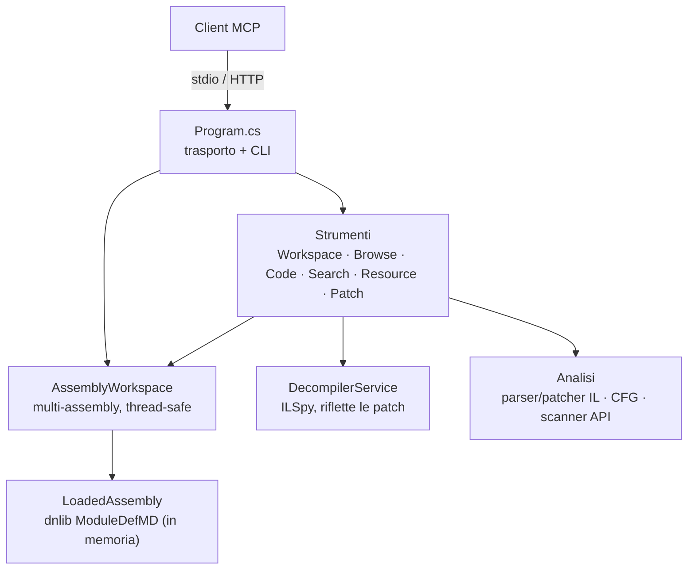

# Personalizzazione e funzionamento

[🇬🇧 English](../en/tweaking.md) · 🇮🇹 Italiano

## Architettura



- **Workspace.** Gli assembly sono caricati da una copia in byte, così il file su disco non viene mai bloccato e un assembly patchato può esservi riscritto sopra. Ogni assembly ha un id; gli strumenti usano quello attivo o un argomento `assembly`. L'accesso è protetto da un lock lettori/scrittore perché le richieste MCP possono essere parallele.
- **Decompilatore.** Avvolge il motore di ILSpy. Se un assembly non è modificato ne decompila il file; una volta patchato o rinominato, il modulo viene prima serializzato in memoria, così il C# corrisponde sempre allo stato corrente. I risultati sono in cache per versione dell'assembly.
- **Analisi.** Un parser/patcher di IL testuale (round-trip del 100% delle istruzioni di `dnlib.dll`), un costruttore di grafo di flusso a blocchi di base e uno scanner di API a regole.

## Strumenti

I membri si indicano con il **token di metadati** (`0x06000012`), restituito e accettato da ogni strumento. Funzionano anche i nomi quando non ambigui: `Namespace.Tipo`, `Esterno+Interno`/`Esterno/Interno`, `Namespace.Tipo::Metodo`, `Namespace.Tipo::Metodo(int32,string)`. Gli strumenti di elenco sono paginati (`offset`, `limit`, `nextOffset`).

| Area | Strumenti |
|---|---|
| Workspace | `load_assembly`, `list_assemblies`, `set_active_assembly`, `unload_assembly`, `get_assembly_info`, `list_assembly_references` |
| Esplorazione | `list_namespaces`, `list_types`, `get_type`, `find_methods`, `find_members`, `get_method`, `get_entry_points`, `list_pinvokes`, `get_static_field_values` |
| Codice | `decompile`, `decompile_assembly_attributes`, `disassemble`, `get_method_il`, `get_control_flow_graph`, `read_bytes`, `export_project` |
| Riferimenti incrociati | `find_strings`, `find_callers`, `find_callees`, `find_field_references`, `find_type_usages`, `find_derived_types` |
| Sicurezza | `scan_suspicious_apis` (conteggi per categoria), indizi di offuscamento in `get_assembly_info` |
| Risorse | `list_resources`, `get_resource` |
| Patch¹ | `patch_method_il`, `replace_method_body`, `nop_instructions`, `rename_member`, `save_assembly` |

¹ Nascosti quando il server gira con `--read-only`.

### Prompt

- `triage_assembly` — primo sguardo strutturato a un assembly sconosciuto.
- `malware_triage` — capacità, staging del payload, IOC, mappatura MITRE ATT&CK.
- `find_secrets` — credenziali, chiavi e stringhe di connessione hardcoded.

### Risorse

- `dotnet://assemblies` — gli assembly caricati.
- `dotnet://{assembly}/info` — panoramica dell'assembly.
- `dotnet://{assembly}/source/{member}` — C# decompilato per un nome di tipo o un token di membro.

## Sintassi di patch IL

`patch_method_il` sostituisce `removeCount` istruzioni a partire da un offset IL. Per impostazione predefinita sovrascrive tante istruzioni quante ne inserisci; `0` inserisce senza rimuovere. La sintassi è ilasm/ILSpy e accetta il formato esatto stampato da `get_method_il`, così gli elenchi si possono reincollare:

```text
ldarg a                                         // parametro per nome, indice o A_n
brtrue IL_0000                                  // target = istruzione del corpo originale
ldstr "denied\n"
call void [System.Console]System.Console::WriteLine(string)
br #0                                           // target = 1ª istruzione di questo frammento
ldsfld int32 MyApp.Config::Retries
callvirt instance int32 System.String::get_Length()
switch (IL_0010, IL_0020)
```

Branch e gestori di eccezioni che puntavano a istruzioni rimosse vengono reindirizzati alla sostituzione; le forme di branch corte/lunghe sono riottimizzate e MaxStack ricalcolato. `replace_method_body` sostituisce un intero corpo (con possibilità di ridefinire le variabili locali); `nop_instructions` azzera un intervallo mantenendo validi i target; `rename_member` rinomina un tipo/metodo/campo/proprietà/evento (e, per i tipi, il namespace). `save_assembly` mantiene stabili i token di metadati e rifiuta di sovrascrivere un file se non con `overwrite=true`.

## Trasporti: stdio e HTTP

```
mcp-dotnet [--transport stdio|http] [opzioni]
```

| Opzione | Predefinito | Significato |
|---|---|---|
| `--transport stdio\|http` | `stdio` | trasporto |
| `--host <addr>` | `127.0.0.1` | indirizzo di bind HTTP (loopback) |
| `--port <n>` | `5005` | porta HTTP |
| `--path <path>` | `/mcp` | percorso dell'endpoint HTTP |
| `--allowed-host <host>` | — | valore `Host` ammesso in più (ripetibile) |
| `--ssl-certfile <file>` / `--ssl-keyfile <file>` | — | TLS (PEM; o PKCS#12 senza key file) |
| `--no-auth` | off | disabilita l'auth bearer (solo bind loopback) |
| `--gen-token` | — | stampa un token bearer casuale ed esce |
| `--read-only` | off | disabilita gli strumenti di patch/rename/save (`MCP_DOTNET_READONLY=1`) |
| `--log-level <level>` | `Warning` | Trace…Error; i log vanno su stderr |

**Auth.** Il trasporto HTTP legge il token bearer da `MCP_DOTNET_HTTP_TOKEN`. Su un bind loopback senza token e senza `--no-auth`, viene generato e stampato all'avvio un token effimero. I client inviano `Authorization: Bearer <token>`. Una allow-list sull'header `Host` protegge dal DNS-rebinding; su bind loopback sono accettati solo i nomi localhost.

**Fuori dal loopback** il bind richiede un token (altrimenti è rifiutato) e senza TLS il server avvisa che token e dati viaggiano in chiaro — mettilo dietro TLS (`--ssl-certfile`/`--ssl-keyfile`) o un reverse proxy.

## Console

`console.bat` apre una GUI nativa WPF (la compila al primo avvio se serve): un'intestazione con il selettore di **profilo** del server (Nuovo/Elimina) e **Avvia server / Ferma / Riavvia**, una scheda **Overview** con un pannello server (stato, endpoint, PID, uptime, richieste/avvisi/errori, ultimo self-test, percorso del binario, pulsanti Self-test e Copia endpoint) accanto a un pannello **Workspace** live che elenca gli assembly caricati da qualunque client collegato a quel server, **Settings** (host/porta/percorso/livello di log/read-only per profilo), **Transport** (token bearer, `--no-auth`, certificato/chiave TLS), **Maintenance** (Build, Esegui test, crea il pacchetto `Distribution/`, impacchetta lo strumento NuGet) e **Integration** (registra/riverifica Claude Code, Claude Desktop e Codex, con un avviso se Claude Desktop è in esecuzione — vedi [Limite noto](#limite-noto-claude-desktop-sovrascrive-la-propria-configurazione)). Sotto, un log filtrabile e ricercabile (error/warning/status/request/debug, autoscroll, wrap, save/clear) e un pannello **Problems** (errori + avvisi, copia/pulisci), con una barra di stato che mostra il job in corso e i totali.

Gestisce solo il **trasporto HTTP** (c'è qualcosa da avviare, fermare e osservare); per stdio non c'è nulla da sorvegliare, perché è il client a lanciare quel server. Se il Windows Desktop Runtime non è disponibile, `console.bat` ripiega automaticamente su `console.ps1` (stessa cartella), una console testuale senza dipendenze con le stesse azioni principali (build, avvio/arresto, stato/controllo di salute, coda del log, generazione di un token, esecuzione dei test) — anche la scelta giusta per una sessione non interattiva o scriptata.

### Limite noto: Claude Desktop sovrascrive la propria configurazione

Claude Desktop mantiene una copia in memoria di `claude_desktop_config.json` mentre è in esecuzione e può sovrascrivere il file su disco con quella copia (ad esempio quando salva altre preferenze), annullando silenziosamente una modifica fatta da `install.ps1` o dalla scheda Integration della console mentre l'app restava aperta. Entrambi ora avvisano quando Claude Desktop è in esecuzione al momento della registrazione. Per un aggiornamento garantito: chiudi completamente Claude Desktop (icona in tray > Quit, non solo la finestra), registra, poi riavvialo.


## Note di sicurezza

- Il server fa **solo analisi statica** e non esegue mai un assembly analizzato. La patch modifica un modello in memoria che salvi esplicitamente.
- `--read-only` (o `MCP_DOTNET_READONLY=1`) rimuove `patch_method_il`, `replace_method_body`, `nop_instructions`, `rename_member` e `save_assembly`.
- HTTP: loopback + token bearer per impostazione predefinita; `--no-auth` solo su loopback; bind non-loopback senza TLS segnalato; allow-list `Host` attiva.
- Codice decompilato, stringhe e risorse sono **contenuti di terze parti**. Il server li restituisce come dati, mai come istruzioni, ma evita di combinare l'analisi di un campione non fidato con strumenti ad alto impatto (email, shell, browser) nella stessa sessione, e tratta come non fidati i percorsi che un campione referenzia.
- `save_assembly`, `get_resource(saveTo=…)` ed `export_project` scrivono nei percorsi che indichi, con i permessi del server.

## Distribuzione

`Scripts/pack-dist.ps1` crea un pacchetto pronto all'uso in `Distribution/`:

- `Distribution/mcp-dotnet/` — i binari pubblicati del server (`app/`), `Scripts/` (install/setup/console), la documentazione e LICENSE/NOTICE/CHANGELOG, con un `RUNME.txt`. L'utente lo scompatta ed esegue `Scripts/install.ps1 -NoBuild` (che registra il binario in `app/`) — senza compilare.
- `Distribution/mcp-dotnet-<versione>.zip` — uno zip del pacchetto.
- `Distribution/mcp-dotnet.<versione>.nupkg` — il pacchetto NuGet `dotnet tool` / server MCP.

Dipendente dal framework per impostazione predefinita (richiede il runtime .NET 10). Per un pacchetto che non richiede nulla sul computer di destinazione:

```powershell
powershell -ExecutionPolicy Bypass -File .\Scripts\pack-dist.ps1 -SelfContained -Runtime win-x64
```

`Distribution/` è output di build ed è ignorato da git. Lo zip della release GitHub è creato separatamente da `Scripts/publish_me.bat` dai sorgenti tracciati (`git archive`).

## Compilazione, test, struttura

```bash
dotnet build mcp-dotnet.slnx -c Release
dotnet test mcp-dotnet.slnx
powershell -ExecutionPolicy Bypass -File Scripts/flatten-bin.ps1   # appiattisce bin/ a solo server + console (DLL/EXE)
```

`Scripts/install.ps1` e l'azione Build della console eseguono il passo di appiattimento automaticamente; chiamalo tu stesso dopo un semplice `dotnet build`.

```
src/MCPPOC/            server (mcp-dotnet)
  Workspace/           workspace multi-assembly, thread-safe
  Analysis/            parser/patcher IL, servizio ILSpy, scanner API, CFG, risorse
  Tools/               strumenti MCP, raggruppati per area
  Server/              setup DI, trasporti, prompt, risorse
Console/               console GUI WPF (mcp-dotnet-console, solo Windows; vedi mcp-dotnet.windows.slnx)
tests/MCPPOC.Tests/    test unitari, patch end-to-end e protocollo MCP
tests/TestTarget/      assembly deterministico analizzato e patchato dai test
tests/fixtures/        binari di terze parti usati come input dei test
Scripts/               install.ps1, setup.bat, console.bat/.ps1, install.sh, pack-dist.ps1, helper di pubblicazione
bin/                   server + console GUI, appiattiti su un livello (ignorato da git; Scripts/flatten-bin.ps1)
obj/                   output di compilazione, per progetto (ignorato da git; vedi Directory.Build.props)
Distribution/          output di Scripts/pack-dist.ps1 (ignorato da git)
```

## Modifiche incompatibili rispetto all'originale 1.x

I nomi degli strumenti sono ora snake_case raggruppati. `ListTypesRegex`/`SearchTypes` → `list_types`; `Find_Methods_By_Name` → `find_methods`; `GetMethodILBodyByRID` → `get_method_il`; `Decompile_Method_By_RID` → `decompile`; `ExtractControlFlowGraph` → `get_control_flow_graph`; `FindMethodReferences` → `find_callers`; `FindStringLiterals`/`FindStringReferences` → `find_strings`; `UpdateMethodInstructions` → `patch_method_il`; `ReadMemoryData` → `read_bytes`; `ListFields`/`ListProperties`/`ListEvents` → `find_members`. I metodi si possono ancora indicare per RID (es. `"12"`).
